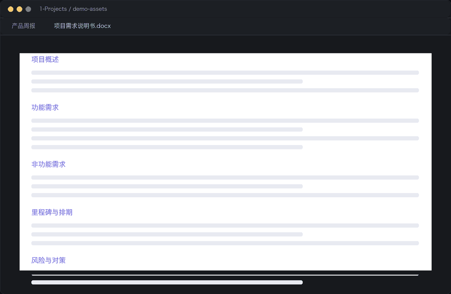
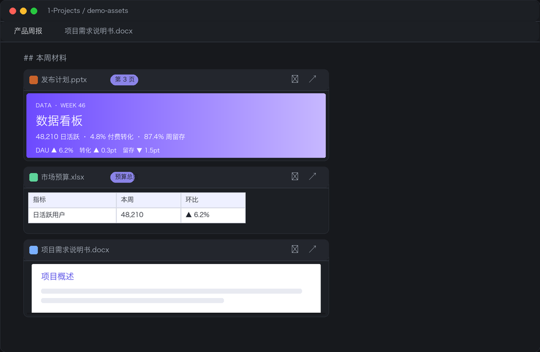
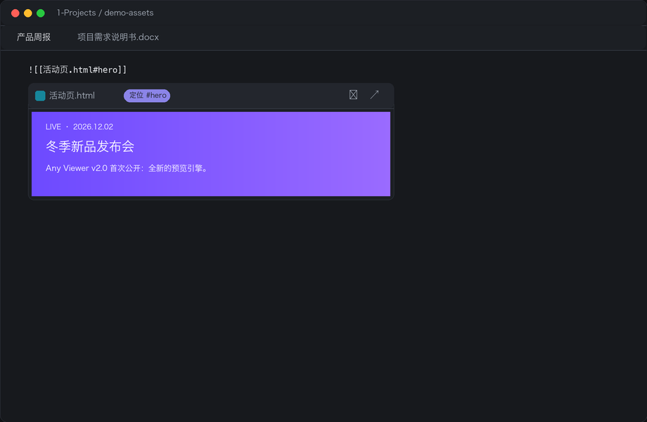
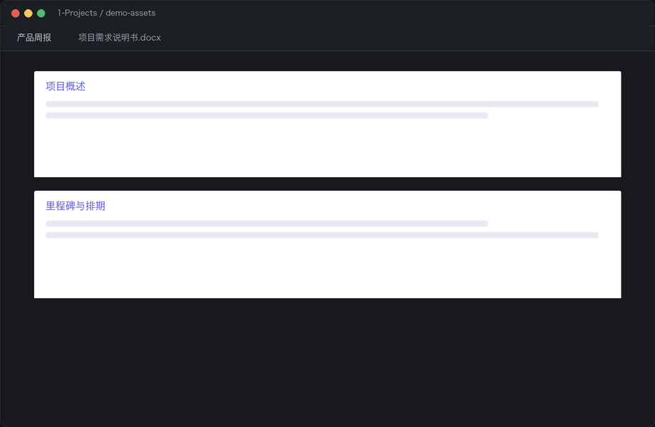
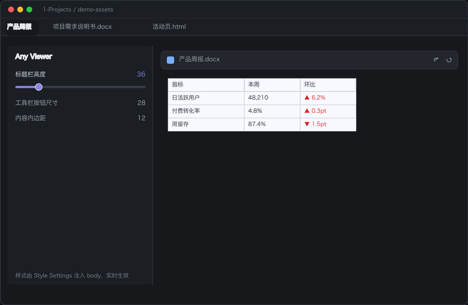

# Obsidian Any Viewer

[](https://github.com/tingke/obsidian-any-viewer/releases)
[](https://github.com/tingke/obsidian-any-viewer/actions/workflows/release.yml)
[](LICENSE)

**English** | [中文](README.zh.md)

An Obsidian plugin to **insert and preview any file type** inside your notes — Word, Excel, PowerPoint, HTML, CSV and more. Unsupported formats get a neat file card that opens with the system default app.

> Package name `obsidian-any-viewer`, plugin ID `any-viewer`.


## ✨ What's new in v0.6

- **docx outline panel**: an H1–H9 outline tree (with page numbers) beside docx tabs — click to jump to a section
- **In-document search**: `Ctrl/Cmd+F` inside tabs opens a native-style search bar with highlighting, match count and jump navigation; rebindable under Settings → Hotkeys
- **Reading position memory**: tabs remember where you left off (and which worksheet you were on) and restore it on reopen. Fragment locate always wins; embeds never participate
- **HTML source mode**: flip any HTML view between rendered and syntax-highlighted source
- **Single-element extraction**: `![[page.html#hero]]` renders just that element instead of the whole page
- **Edge-to-edge tabs**: tab content fills the pane — no card border
- **Appearance tweaks**: with [Style Settings](https://github.com/mgmeyers/obsidian-style-settings) installed, fine-tune density, file icon colors and shapes (zero visual change without it)



## Supported file types

### Inline embeds + tab view

| Format | Rendering |
|---|---|
| `.docx` | High-fidelity rendering (styles, page breaks, headers/footers) via [docx-preview](https://github.com/VolodymyrBaydalka/docxjs) |
| `.xlsx` `.xlsm` | **Real cell styling**: fills (incl. theme colors & tint), fonts, borders, alignment, merged cells, column widths, row heights, number formats via [exceljs](https://github.com/exceljs/exceljs) |
| `.xls` `.csv` `.tsv` | Table rendering with sheet tabs via [SheetJS](https://sheetjs.com/) |
| `.pptx` | Slide rendering (great for image-based decks) via [pptx-preview](https://www.npmjs.com/package/pptx-preview) |
| `.html` `.htm` | Sandboxed iframe (srcdoc with inlined stylesheets; script execution configurable) |



### File card fallback

Any other type Obsidian doesn't natively render (`.zip`, `.exe`, `.psd`, `.sketch`, …) becomes a file card: type icon + filename + size.

- Click → open with the system default app
- Shift+click → reveal in the system file manager (desktop only)

### Left untouched

Images, audio, video, PDF, Markdown and Canvas are rendered by Obsidian itself.

## Usage

### Easy insertion (any type)

- **Command palette** → `Any Viewer: 插入本地文件（任意类型）`, or click the **paperclip** ribbon icon
- **Paste** a copied file with `Ctrl/Cmd+V`, or **drag & drop** it into the editor
- Files are stored in the vault (location configurable) and an `![[file]]` embed is inserted at the cursor; name conflicts are auto-numbered

### Embeds & sizing

Write `![[filename.ext]]` in a note to preview it inline:

| Syntax | Effect |
|---|---|
| `![[report.xlsx]]` | Default size (full width, default height from settings) |
| `![[report.xlsx\|300]]` | Card sized to 300px wide; content keeps natural size and scrolls inside |
| `![[doc.docx\|x400]]` | Height only: 400px tall |
| `![[doc.docx\|300x400]]` | 300px wide + 400px tall |

### Display syntax (fragments)

Pick which part of the file to show — combines freely with the sizing syntax
(fragment before the `\|`, size after):

| Syntax | Effect |
|---|---|
| `![[deck.pptx#page=3]]` | Only slide 3 (single page ≡ `3~3`) |
| `![[deck.pptx#page=3~10]]` | Slides 3–10, stacked (`3~` = to the last slide) |
| `![[doc.docx#page=2]]` | Only page 2 (same range forms as pptx) |
| `![[doc.docx#Conclusion]]` | From the page containing that heading to the end of the document (falls back to the whole file if no heading matches) |
| `![[book.xlsx#Sheet2]]` | Start on the named worksheet (tab bar stays) |
| `![[book.xlsx#A1:D10]]` | Only that cell range |
| `![[book.xlsx#Sheet2!A1:D10]]` | Named worksheet + range |
| `![[book.xlsx#5:20]]` | Only rows 5–20 |
| `![[page.html#header]]` | Renders **only that element** (v0.6: single-element extraction) |



Range rules: `-` works like `~`; reversed ranges normalize automatically
(`8~3` → `3~8`); the end clamps to the last page; an out-of-bounds start or an
unresolved heading falls back to the whole file. The embed header shows a badge
("Pages 3–10", "Heading …"). **Fragments scope the inline embed only** (a
worksheet/range fragment hides the sheet tab bar) — **opening the file in a tab
shows the whole document and auto-scrolls to the fragment position** (like
Obsidian's native PDF embeds). Note that `#element-id` means different things
per channel: embeds extract the element, tabs render the full page and scroll.

Embeds have a header bar: **click the filename** or **double-click the content**
to open the file in a tab; header buttons open a tab or the system app (HTML
embeds additionally get a reading/source toggle).

### Tab view

Clicking `.docx/.xlsx/.xls/.csv/.tsv/.pptx/.html/.htm` files in the explorer opens them in a full-height preview pane — **edge-to-edge, no card border**:


- **docx outline panel**: H1–H9 tree on the left, click to jump, collapsible
- **In-document search**: `Ctrl/Cmd+F` (rebindable in Settings → Hotkeys) opens the search bar; `Enter` / `Shift+Enter` to jump between matches, `Esc` to close; supported for docx / xlsx / pptx
- **Reading position memory**: close and reopen — the view scrolls back to where you left off (xlsx also restores the last active worksheet)



### HTML source mode

Both HTML embeds (header button) and HTML tabs (pane action bar) offer a reading/source toggle: source mode shows the raw HTML with syntax highlighting (oversized files are truncated). `#element-id` fragment locating only applies in reading mode.


### Appearance tweaks (Style Settings)

With [Style Settings](https://github.com/mgmeyers/obsidian-style-settings) installed, its panel gains an **Any Viewer** group:

- **Density & sizes**: header height, toolbar buttons, content padding, table cell padding, table font size, scrollbar width, selection/hover tint strength
- **File icon colors**: Word / Excel / PowerPoint / HTML (off by default — icons follow the host theme palette)
- **Shapes**: compact mode, tighter/larger/square corners, flat embeds, no table stripes

Every option defaults to the plugin's built-in value — **without Style Settings, or with everything untouched, the visuals are exactly as they've always been**.



### Coexisting with other plugins

- Extensions claimed by other plugins are skipped automatically (with a notice); inline embeds keep working
- Turning a format **off** in settings makes this plugin completely hands-off that type (view registration *and* embeds — restart required), leaving it to plugins like styled-ms-office-viewer or CodeSpace

## Installation

### Manual

1. Download `main.js`, `styles.css`, `manifest.json` from the [latest release](https://github.com/tingke/obsidian-any-viewer/releases)
2. Put them in `<your vault>/.obsidian/plugins/any-viewer/`
3. Restart Obsidian → Settings → Community plugins → enable **Any Viewer**

### BRAT

BRAT → Add Plugin → paste this repository's Git URL.

## Privacy, cost & network access

- **Free, no paywall**: Any Viewer is MIT-licensed freeware — no paid features, no ads, no license keys, no upsells. Nothing here requires payment, now or later.
- **No network access**: files are parsed and rendered entirely on your device. The plugin itself makes **zero network requests** — no telemetry, no analytics, no AI calls; your documents never leave your vault.
- **One caveat**: HTML embeds render local `.html` files inside a sandboxed iframe. If such a file itself references external URLs (CDN fonts / scripts / images), those assets are loaded by the embedded page — governed by Obsidian's CSP and the "Allow scripts in HTML" setting (on by default, can be turned off).

## Building from source

```bash
npm install
npm run build     # produces main.js
npm test          # fragment parser + Style Settings consistency checks
```

The demo GIFs in this README are generated by `promo/make_demo_gifs.py` (`python3 promo/make_demo_gifs.py`) — regenerate after visual changes.

## Known limitations

- Legacy binary formats (`.doc`, `.ppt`) can't be previewed inline (file card instead); they still open with the system app
- In HTML embeds, external `<script src>` may be blocked by Obsidian's CSP; inline scripts run fine
- "Open with system app / reveal in file manager" is desktop-only
- `.pptx` preview is static — animations and media don't play
- In-document search covers docx / xlsx / pptx tabs only (HTML body lives inside an iframe; embeds have no search bar)
- Reading position memory applies to the tab channel only; fragment locating always wins over memory restore
- The docx outline relies on standard built-in heading styles (canonical style ids written by Word); generators using non-standard style ids silently show no outline
- Compared to WASM-based viewers (e.g. styled-ms-office-viewer), docx/pptx fidelity is lower; both can coexist — tabs for them, inline embeds for Any Viewer

## Acknowledgements

- Rendering: [docx-preview](https://github.com/VolodymyrBaydalka/docxjs), [exceljs](https://github.com/exceljs/exceljs), [SheetJS](https://sheetjs.com/), [pptx-preview](https://www.npmjs.com/package/pptx-preview)
- HTML sandbox approach adapted from [mnaoumov/obsidian-embed-html](https://github.com/mnaoumov/obsidian-embed-html)
- Research phase referenced [obsidian-file-link](https://github.com/marcjulianschwarz/obsidian-file-link), [Styled MS Office Viewer](https://github.com/zoroaster1x/Styled-MS-Office-Viewer-for-Obsidian) and other community plugins

## License

[MIT](LICENSE)
