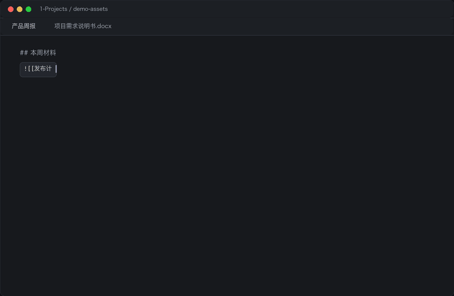
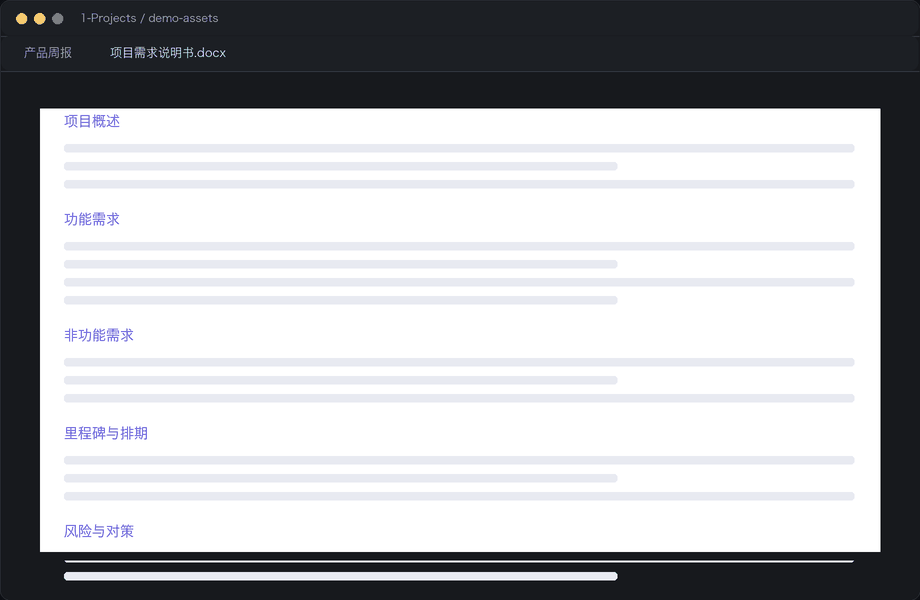
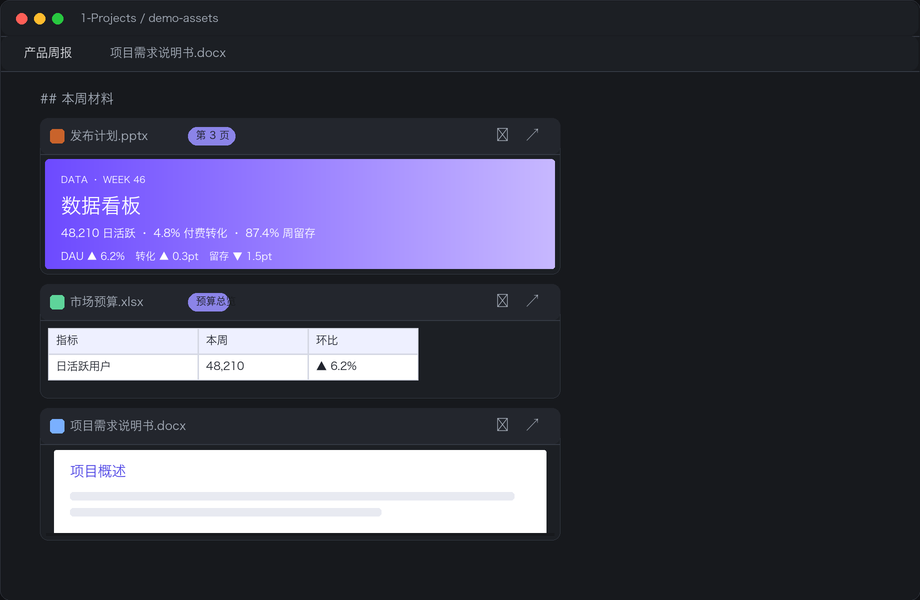
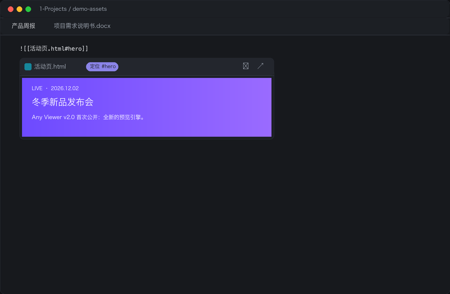
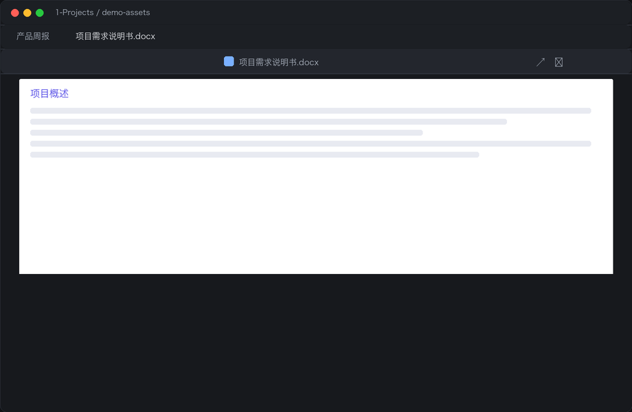
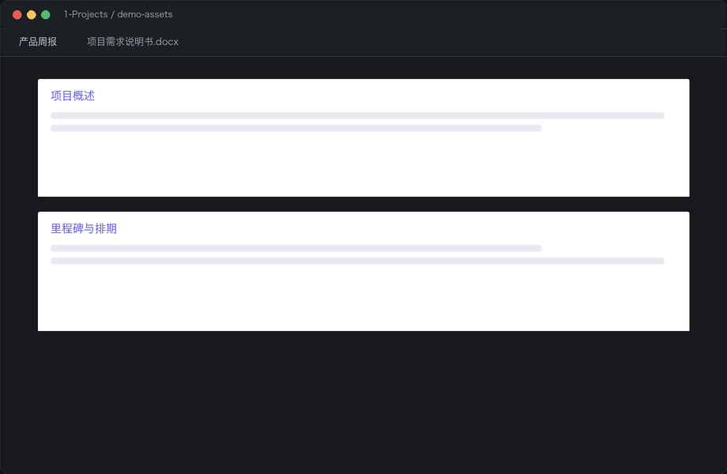
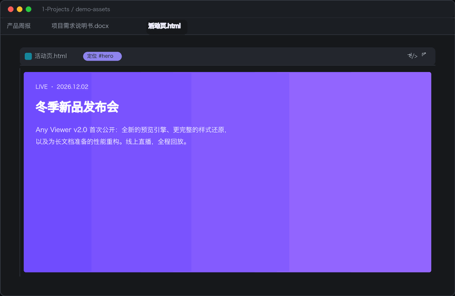
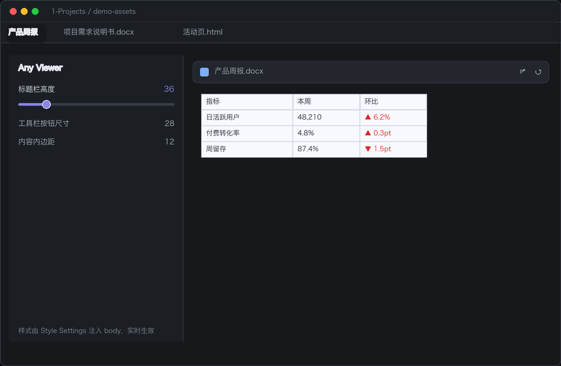

# Obsidian Any Viewer（中文说明）

[](https://github.com/tingke/obsidian-any-viewer/releases)
[](https://github.com/tingke/obsidian-any-viewer/actions/workflows/release.yml)
[](LICENSE)

[English](README.md) | **中文**

一个 Obsidian 插件：在笔记中**插入并预览任意类型的文件** —— Word、Excel、PowerPoint、HTML、CSV 等，无法预览的格式显示文件卡片，一键调用系统默认应用打开。

> 项目名 `obsidian-any-viewer`，插件 ID `any-viewer`。



## ✨ v0.6 新特性

- **docx 大纲面板**：docx 标签页左侧显示 H1–H9 大纲树（含页码），点击跳转对应章节
- **预览内搜索**：标签页内 `Ctrl/Cmd+F` 呼出搜索条（原生风格），高亮全部命中、计数、逐处跳转；快捷键可在「设置 → 快捷键」改绑
- **阅读位置记忆**：标签页会记住每个文件上次读到的位置与工作表，再次打开自动回到原处（片段定位优先，嵌入不参与）
- **HTML 源码模式**：html 视图可在「阅读 / 源码」间一键切换，源码带语法高亮
- **元素单提取**：`![[网页.html#hero]]` 只渲染该元素区块，而不是整个页面
- **标签页填充**：标签页内容顶格填满窗格，去卡片外框
- **外观自定义**：安装 [Style Settings](https://github.com/mgmeyers/obsidian-style-settings) 后可微调密度尺寸、文件图标颜色与形态（未安装时视觉零变化）



## 支持的文件类型

### 嵌入预览 + 标签页视图

| 格式 | 渲染方式 |
|---|---|
| `.docx` | 高保真渲染（保留样式、分页、页眉页脚），基于 [docx-preview](https://github.com/VolodymyrBaydalka/docxjs) |
| `.xlsx` `.xlsm` | **真实单元格样式渲染**：填充色（含主题色/tint）、字体、边框、对齐、合并单元格、列宽行高、数字格式，基于 [exceljs](https://github.com/exceljs/exceljs) |
| `.xls` `.csv` `.tsv` | 表格渲染 + 多工作表标签切换，基于 [SheetJS](https://sheetjs.com/) |
| `.pptx` | 幻灯片渲染（图片型幻灯片还原度高），基于 [pptx-preview](https://www.npmjs.com/package/pptx-preview) |
| `.html` `.htm` | 沙箱 iframe 渲染（srcdoc + 内联样式表，可配置是否允许脚本） |



### 文件卡片兜底

除 Obsidian 原生支持的格式（图片 / 音视频 / PDF / md）外，**任意其他类型**（`.zip`、`.exe`、`.psd`、`.sketch`……）显示为文件卡片：类型图标 + 文件名 + 大小。

- 单击卡片 → 系统默认应用打开
- Shift+单击 → 在系统文件管理器中显示（仅桌面端）

### 不干预的格式

图片、音频、视频、PDF、Markdown、Canvas 由 Obsidian 原生渲染，插件不介入。

## 使用

### 便捷插入（任意类型）

- **命令面板** → `Any Viewer: 插入本地文件（任意类型）`，或点击左侧 **回形针图标**
- **直接粘贴**：复制文件后在笔记中 `Ctrl/Cmd+V`
- **直接拖放**：把文件拖进编辑器
- 文件自动存入库（位置可配置），光标处插入 `![[文件]]`；重名自动加序号

### 嵌入与宽高

在笔记中写 `![[文件名.扩展名]]` 即可内嵌预览：

| 语法 | 效果 |
|---|---|
| `![[报表.xlsx]]` | 默认尺寸（宽度随笔记，高度用设置默认值） |
| `![[报表.xlsx\|300]]` | 卡片宽度 300px，内容原始尺寸、内部滚动 |
| `![[文档.docx\|x400]]` | 只调高度：400px 高 |
| `![[文档.docx\|300x400]]` | 宽 300px + 高 400px |

### 显示语法（片段）

指定显示文件的哪一部分，可与宽高语法自由组合（片段在 `\|` 之前，尺寸在后）：

| 语法 | 效果 |
|---|---|
| `![[演示.pptx#page=3]]` | 只显示第 3 页幻灯片（单页 ≡ `3~3`） |
| `![[演示.pptx#page=3~10]]` | 显示第 3–10 页，纵向堆叠（`3~` = 到最后一页） |
| `![[文档.docx#page=2]]` | 只显示第 2 页（区间写法与 pptx 相同） |
| `![[文档.docx#结论]]` | 从「结论」标题所在页起显示到文末（匹配不到标题回退整个文件） |
| `![[表格.xlsx#Sheet2]]` | 直接打开指定工作表（标签栏保留可切换） |
| `![[表格.xlsx#A1:D10]]` | 只显示该单元格区域 |
| `![[表格.xlsx#Sheet2!A1:D10]]` | 指定工作表 + 区域 |
| `![[表格.xlsx#5:20]]` | 只显示第 5–20 行 |
| `![[网页.html#header]]` | 嵌入**只渲染该元素区块**（v0.6：元素单提取） |



区间规则：`-` 等价 `~`；写反自动归一化（`8~3` → `3~8`）；末页越界自动钳到最后一页；起始越界 / 标题找不到回退显示整个文件。嵌入标题栏会显示片段徽标（如「第 3–10 页」「标题 结论」）。**片段只作用于嵌入本身**（xlsx 指定工作表/区域时隐藏标签栏）；**在标签页中打开则显示完整文件并自动跳转到对应位置**（同 Obsidian 原生 PDF 嵌入）。注意 `#元素id` 的两条通道语义不同：嵌入=提取该元素，标签页=渲染整页并滚动定位。

嵌入自带标题栏：**单击文件名**或**双击内容**在标签页中打开；右上角按钮可在标签页打开 / 用系统应用打开（html 嵌入另有「阅读 / 源码」切换按钮）。

### 标签页视图

点击库中的 `.docx/.xlsx/.xls/.csv/.tsv/.pptx/.html/.htm` 文件，用全高视图打开预览——**内容顶格填满窗格，无外框**：



- **docx 大纲面板**：左侧 H1–H9 大纲树，点击跳章，可折叠
- **预览内搜索**：`Ctrl/Cmd+F`（可在设置 → 快捷键中改绑）呼出搜索条，`Enter` / `Shift+Enter` 逐处跳转，`Esc` 关闭；docx / xlsx / pptx 支持
- **阅读位置记忆**：关闭再打开，自动回到上次滚动位置（xlsx 还会恢复上次的工作表）



### HTML 源码模式

html 嵌入的标题栏与 html 标签页的右上角都有「阅读 / 源码」切换：源码模式显示带语法高亮的原始 HTML（超大文件自动截断）。`#元素id` 片段定位仅在阅读模式生效。



### 外观自定义（Style Settings）

安装 [Style Settings](https://github.com/mgmeyers/obsidian-style-settings) 插件后，其面板中会出现 **Any Viewer** 分组，可微调：

- **密度与尺寸**：标题栏高度、工具栏按钮、内容内边距、表格单元格内边距、表格字号、滚动条宽度、选中/悬浮强调色浓度
- **文件图标颜色**：Word / Excel / PowerPoint / HTML 四色（默认关闭，跟随宿主主题色板）
- **形态**：紧凑模式、圆角收紧/放大/直角、嵌入去阴影、表格去斑马纹

所有选项默认值与插件内置值完全一致——**不装 Style Settings、不调任何选项，视觉与未提供该能力时完全相同**。



### 与其他插件的兼容

- 其他插件已注册的扩展名会自动让位（启动时提示），嵌入预览不受影响
- 设置里关闭某类格式 → 本插件完全不接管该类型（注册与嵌入都让出，**重启后生效**），可交给 styled-ms-office-viewer、CodeSpace 等专门插件

## 安装

### 手动安装

1. 从 [Latest Release](https://github.com/tingke/obsidian-any-viewer/releases) 下载 `main.js` / `styles.css` / `manifest.json`
2. 放入库目录：`你的库/.obsidian/plugins/any-viewer/`
3. 重启 Obsidian → 设置 → 第三方插件 → 启用 **Any Viewer**

### BRAT

BRAT → Add Plugin → 填写本仓库 Git URL。

## 隐私、费用与联网披露

- **免费、无付费墙**：Any Viewer 为 MIT 开源免费软件——无付费功能、无广告、无激活码、无内购，任何功能都不需要付费。
- **无网络访问**：所有文件的解析与渲染全部在本机完成，插件自身**不发起任何网络请求**——无遥测、无统计、无 AI 调用，文档不会离开你的库。
- **唯一例外**：HTML 嵌入在沙箱 iframe 中渲染本地 `.html` 文件；若该文件自身引用了外部 URL（CDN 字体 / 脚本 / 图片），这些资源由页面在沙箱内加载——受 Obsidian CSP 与「允许 HTML 运行脚本」设置约束（默认允许，可关闭）。

## 从源码构建

```bash
npm install
npm run build     # 产物：main.js
npm test          # 语法解析 + Style Settings 一致性校验
```

README 中的演示动图由 `promo/make_demo_gifs.py` 生成（`python3 promo/make_demo_gifs.py`），视觉变更后可重新出图。

## 已知限制

- `.doc` / `.ppt` 等老式二进制格式无法在笔记内预览（显示文件卡片），可通过卡片用系统应用打开
- HTML 嵌入中，外部 `<script src>` 可能被 Obsidian CSP 拦截；内联脚本正常执行
- "用系统应用打开 / 在文件管理器中显示"仅桌面端可用
- `.pptx` 为静态预览，不播放动画与音视频
- 预览内搜索仅覆盖 docx / xlsx / pptx 的标签页（html 正文在 iframe 内、嵌入不提供搜索条）
- 阅读位置记忆仅作用于标签页通道；片段定位始终优先于记忆恢复
- docx 大纲依赖标准内置标题样式（Word 写入的 canonical styleId）；非 Word 生成器若使用非标准样式 id，大纲会静默留空
- 与基于 WASM 引擎的标签页查看器（如 styled-ms-office-viewer）相比，docx/pptx 渲染保真度有限；两者可共存——标签页交给对方，笔记内嵌入由 Any Viewer 负责

## 致谢

- [docx-preview](https://github.com/VolodymyrBaydalka/docxjs)、[exceljs](https://github.com/exceljs/exceljs)、[SheetJS](https://sheetjs.com/)、[pptx-preview](https://www.npmjs.com/package/pptx-preview) 提供渲染能力
- HTML 沙箱渲染方案参考了 [mnaoumov/obsidian-embed-html](https://github.com/mnaoumov/obsidian-embed-html)
- 调研期间参考了 [obsidian-file-link](https://github.com/marcjulianschwarz/obsidian-file-link)、[Styled MS Office Viewer](https://github.com/zoroaster1x/Styled-MS-Office-Viewer-for-Obsidian) 等社区插件

## License

[MIT](LICENSE)
